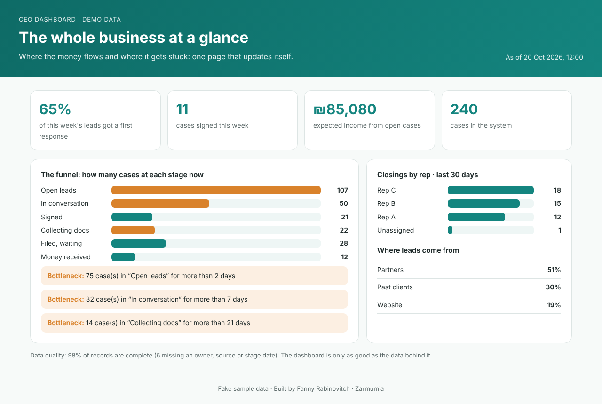

# CEO Dashboard

**The whole business at a glance: where the money flows and where it gets stuck.**



Most small-business CRMs are full of data, but the owner still can't answer simple questions: *How many leads are waiting? Where are cases stuck? What's coming in next quarter?* This is a single page that answers them. It's macro, not granular: the funnel, the bottlenecks and the money, nothing more.

## What it shows

- **Response rate:** the share of this week's leads that got a first response.
- **Cases signed this week**, and **expected income** from open cases (fee × probability by stage).
- **The funnel:** how many cases sit in each stage right now.
- **Bottlenecks:** cases stuck in a stage longer than its limit, highlighted in amber.
- **Closings by rep** and **lead sources**.
- **Data quality:** what share of records are complete. The dashboard is only as good as the data behind it, so it says so openly.

## Run it

It's static HTML and plain JavaScript, with no build step and no framework.

```bash
python3 -m http.server   # then open http://localhost:8000
```

It also works on GitHub Pages as-is.

## Use your own data

The page reads `data/sample.json`: a list of cases with `stage`, `owner`, `source`, `created_at`, `first_contact_at`, `stage_since`, `signed_at` and `expected_fee`.

Point it at any export or API that can produce this shape: a scheduled CRM export, a Make/Zapier/n8n scenario, or a small script. Stage names, bottleneck limits and probabilities are plain constants at the top of `metrics.js`.

Regenerate fake demo data with `npm run sample`.

## Tests

```bash
npm test   # node --test, no dependencies
```

All the calculations live in `metrics.js` as pure functions, separate from the page. That way they're tested, and they can be reused in a report, an email digest or a different UI.

---

Built by **Fanny Rabinovitch · Zarmumia**: operations, automation and AI workflows for small and growing businesses. All data in this repo is fake.
